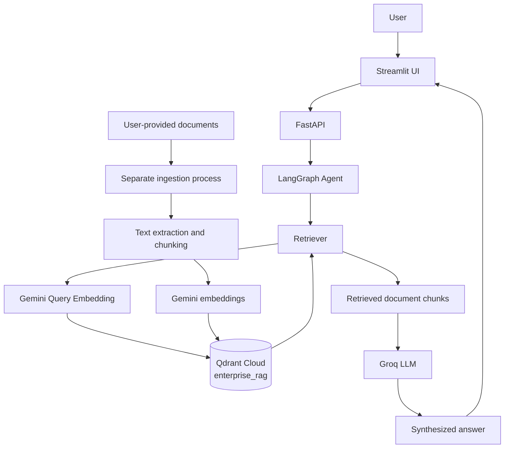
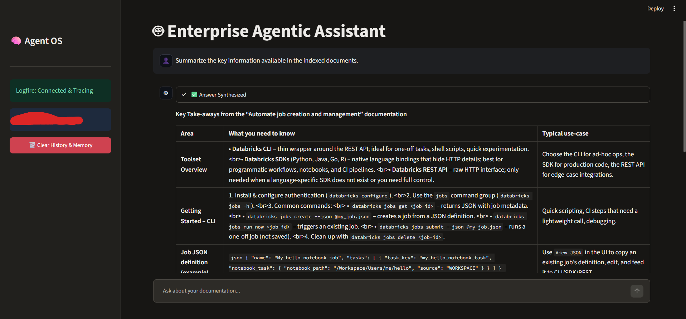

# Enterprise Agentic RAG

An agentic Retrieval-Augmented Generation (RAG) application that retrieves relevant information from documents stored in Qdrant and uses an LLM to synthesize an answer. The project exposes a FastAPI backend and a Streamlit chat interface.

> **Repository:** https://github.com/vaishnaviag30/Enterprise-Agentic-RAG

## Features

- **Document ingestion:** Extracts text from supported document formats, splits it into chunks, generates embeddings, and stores the resulting vectors and metadata in Qdrant.
- **Semantic retrieval:** Searches the `enterprise_rag` Qdrant collection for relevant document chunks.
- **Agent workflow:** Uses LangGraph to coordinate retrieval and answer-generation steps.
- **Answer synthesis:** Uses Groq-hosted LLM inference to generate responses from retrieved context.
- **Embeddings:** Uses the Google Gemini embedding integration.
- **API:** Provides a FastAPI service for querying the RAG workflow.
- **User interface:** Provides a Streamlit-based chat interface.
- **Observability:** Integrates Logfire for tracing.

## Technology Stack

| Component | Technology |
|---|---|
| Backend API | FastAPI |
| Agent orchestration | LangGraph |
| Vector database | Qdrant Cloud |
| Embeddings | Google Gemini |
| LLM inference | Groq |
| Frontend | Streamlit |
| Observability | Logfire |
| Language | Python |

## Architecture



### Query flow

1. A user submits a question through the Streamlit interface.
2. The interface sends the query to the FastAPI backend.
3. The LangGraph workflow coordinates retrieval and response generation.
4. The retrieval service embeds the question and searches the Qdrant `enterprise_rag` collection.
5. Retrieved text is passed into the response-generation step.
6. The LLM synthesizes an answer and returns it to the interface.

### Ingestion flow

Ingestion is a **separate process**. The FastAPI application does not automatically ingest documents when it starts.

The ingestion processor:
1. Reads supported files from the selected input directory.
2. Extracts text using the appropriate loader.
3. Splits the extracted text into chunks.
4. Generates embeddings.
5. Upserts points and their payloads into the Qdrant `enterprise_rag` collection.

The processor can create the collection if it does not already exist. The `--wipe` option is destructive: it can delete the existing collection before ingestion. Use it only when you intentionally want to replace the collection contents.

## Project Structure

```text
.
├── app/
│   ├── agents/
│   │   ├── nodes/
│   │   │   ├── planner.py
│   │   │   ├── responder.py
│   │   │   └── retriever.py
│   │   ├── graph.py
│   │   └── state.py
│   ├── ingestion/
│   │   ├── chunking/
│   │   ├── loaders/
│   │   └── processor.py
│   ├── services/
│   │   └── retrieval/
│   │       ├── embedding.py
│   │       ├── qdrant_service.py
│   │       └── ranking_service.py
│   ├── config.py
│   └── main.py
├── ui/
│   ├── app.py
│   └── st_cloud_ui.py
├── .env.example
├── .gitignore
└── requirements.txt
```

## Prerequisites

- Python 3.10 or a compatible version supported by the dependencies in `requirements.txt`
- A Qdrant Cloud cluster and API key
- A Google Gemini API key
- A Groq API key
- A Logfire token (optional if observability is not required by your local configuration)

## Setup

### 1. Clone the repository

```bash
git clone https://github.com/vaishnaviag30/Enterprise-Agentic-RAG.git
cd Enterprise-Agentic-RAG
```

### 2. Create and activate a virtual environment

Windows:

```cmd
python -m venv .venv
.venv\Scripts\activate
```

macOS / Linux:

```bash
python -m venv .venv
source .venv/bin/activate
```

### 3. Install dependencies

```bash
python -m pip install -r requirements.txt
```

### 4. Configure environment variables

Create a `.env` file in the project root using `.env.example` as a template:

```env
GEMINI_API_KEY=your_gemini_api_key

QDRANT_CLUSTER_ENDPOINT=your_qdrant_cluster_url
QDRANT_API_KEY=your_qdrant_api_key

GROQ_API_KEY=your_groq_api_key
GROQ_FALLBACK_API_KEY=your_optional_fallback_groq_api_key

LOGFIRE_TOKEN=your_logfire_token
```

Replace the placeholder values with your own credentials. Never commit `.env` or share API keys publicly. The repository's `.gitignore` is configured to exclude `.env`.

## Run the application

Start the FastAPI backend from the project root:

```bash
uvicorn app.main:app --reload
```

The API root should be available at:

- `http://127.0.0.1:8000/`
- Interactive API documentation: `http://127.0.0.1:8000/docs`

In a **second terminal**, activate the same virtual environment and start Streamlit:

```bash
python -m streamlit run ui/app.py
```

Open the local URL printed by Streamlit, normally:

- `http://localhost:8501`

Keep both processes running while using the application.

## Ingest your own documents

The repository intentionally excludes the original `DATA/` documents. Add documents that you are authorized to use to a local data directory, then run the ingestion processor.

Example command patterns from the ingestion processor:

```bash
python -m app.ingestion.processor DATA/true_data true
```

Or, to process a directory using the processor's default source-type routing:

```bash
python -m app.ingestion.processor DATA
```

Use a directory containing your own permitted documents. The exact source-type argument and folder layout should match the routing logic in `app/ingestion/processor.py`.

**Important:** Do not add confidential, copyrighted, customer, or otherwise restricted documents to a public repository unless you have permission to redistribute them. Keep local document directories out of Git.

## API

The FastAPI application includes these routes:

| Method | Endpoint | Purpose |
|---|---|---|
| `GET` | `/` | API health/status response |
| `POST` | `/query` | Submit a question to the LangGraph RAG workflow |
| `GET` | `/graph` | Return a visualization of the agent graph |

Example query request:

```bash
curl -X POST "http://127.0.0.1:8000/query" \
  -H "Content-Type: application/json" \
  -d '{
    "q": "Summarize the key information in the indexed documents.",
    "thread_id": "default_user"
  }'
```

Check `http://127.0.0.1:8000/docs` for the exact request schema exposed by the running API.

## Screenshots

### Streamlit interface and RAG response



## Security Notes

- Do not commit `.env`, API keys, access tokens, or private endpoints.
- `.env.example` contains placeholders only; populate a local `.env` file.
- The document datasets are excluded because redistribution rights have not been confirmed.
- Use your own authorized documents and your own API credentials when running the project.

## Current Scope and Notes

- The application expects a Qdrant collection named `enterprise_rag`.
- Document ingestion is run separately from the FastAPI server.
- A Qdrant collection must contain vectors created with the same embedding configuration used by query-time retrieval.
- The example screenshot demonstrates a generated response; verify important factual claims against the original source documents.

## License

No license has been added to this repository yet. Until a license is selected, others do not automatically receive permission to reuse, modify, or redistribute the code.
